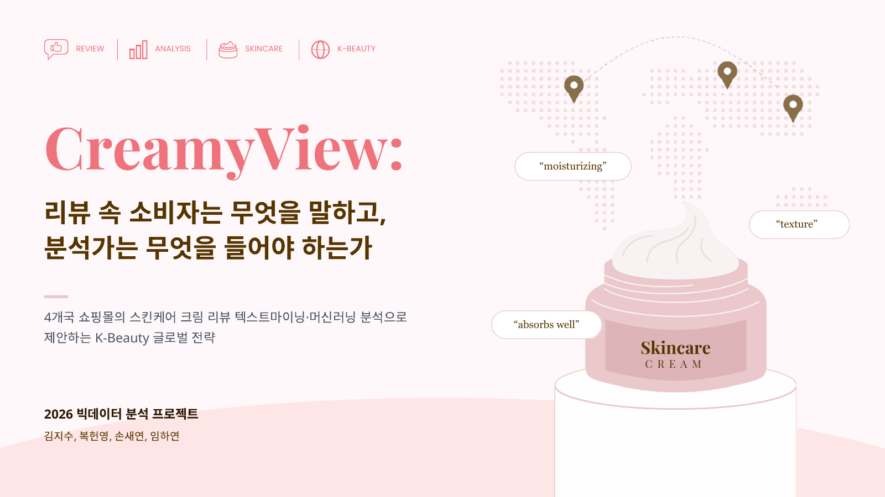
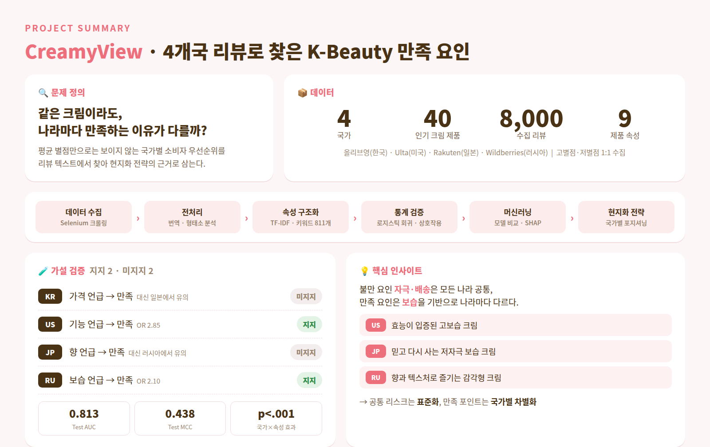

  

# 손새연

### Data Analyst · Data Collector

데이터 수집부터 전처리, 시각화, 분석까지 
**숫자 뒤에 숨은 이야기**를 찾습니다.

 

 

> **데이터 수집 → 품질 점검 → 전처리 → EDA → 모델링 → 해석**에 이르는
> **데이터 생애주기 전반**을 직접 수행하며 성장하고 있습니다.

---

## 🧭 한눈에 보기

| 항목 | 내용 |
|---|---|
| **Role** | Data Analyst / Data Collector |
| **Focus** | 데이터 전처리 · 데이터 시각화 · 데이터 분석 |
| **License** | `SQLD` `ADsP` `사회조사분석사 2급` |
| **Contact** | sonsaeyeon22@gmail.com |
| **Study Log** | [데이터 분석 학습 노트](https://blog.naver.com/hellohandbird) |

---

## 🛠️ Tech Stack

**Data Analysis**

**Collection & Automation**

**Visualization**

---

## ⭐ Featured Project

### 💄 CreamyView — K-Beauty 스킨케어 크림 리뷰 데이터 분석

4개국 쇼핑몰의 스킨케어 크림 리뷰를 텍스트마이닝과 머신러닝으로 분석해
**국가별 K-Beauty 현지화 전략**을 제안한 4인 팀 프로젝트입니다. 

| 기간 · 인원 | 담당 역할 | 사용 기술 | 보고서 |
|:--:|:--:|:--:|:--:|
| 2026 · 4인 | 🇯🇵 일본 파트 전담 (리뷰 수집 · 전처리 · 토픽 분류 · EDA SHAP 분석) | Python · Selenium · Kiwi · statsmodels · scikit-learn · SHAP | [📄 전체 보기](https://github.com/babypotatos/workspace/blob/main/CreamyView_report.pdf) |

---

## 📂 Portfolio

데이터 생애주기를 **한 노트북 안에서** 검증하는 것을 원칙으로 합니다.
품질 점검 → EDA → 모델링 → 진단 → 해석까지, 모든 코드 셀 아래에 **판단이 담긴 해석**을 남깁니다.

| # | 프로젝트 | 기법 | 상태 |
|:--:|---|---|:--:|
| 01 | [보스턴 하우징 가격 결정요인](<https://github.com/babypotatos/workspace/blob/main/보스턴 하우징 가격 결정요인.ipynb>) | 선형회귀 |  |
| 02 | 보험료 결정요인 | 선형회귀 |  |
| 03 | 다이아몬드 가격 예측 | 선형회귀 |  |
| 04 | 하우징 데이터셋 | 선형회귀 |  |
| 05 | 사과 품종 분류 | 로지스틱 회귀 |  |
| 06 | 타이타닉 생존 예측 | 로지스틱 회귀 |  |
| 07 | (미정) | 머신러닝 · 예측 |  |
| 08 | (미정) | 머신러닝 · 예측 |  |
| 09 | (미정) | 머신러닝 · 군집 |  |
| 10 | (미정) | 머신러닝 · 분류 |  |

**공통 모듈** — 품질 점검(`my_qtcheck`) · 시각화(`my_plot`) · 통계 검정(`my_stats`) · 전처리(`my_prep`) · 선형회귀(`my_ols`) · 로지스틱 회귀(`my_logit`)

---

### 📮 Contact

Data Collection · Data Preprocessing · Exploratory Data Analysis · Modeling · Machine Learning

